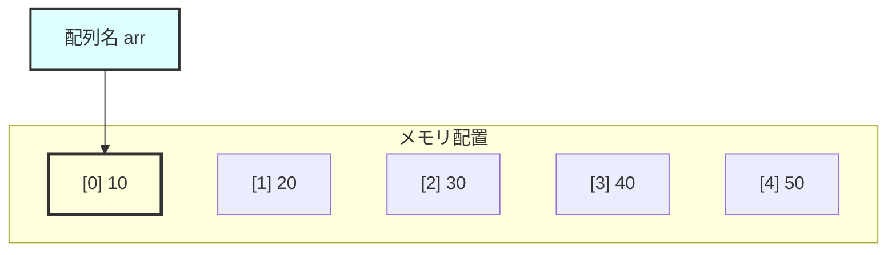
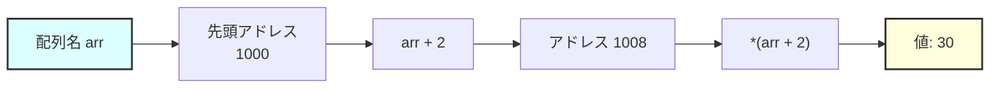

# 配列とポインター

## 対応C規格

- **主要対象**：C90
- **学習内容**：配列とポインターの関係、ポインターを使った配列操作、関数への配列渡し

## 学習目標

この章では、配列とポインターがどのようにつながっているのかを学びます。
完了すると、以下のことができるようになります。

- 配列の名前が「先頭要素へのポインター」に変換される条件を理解する
- ポインター演算を使って、配列の要素を順番に操作できる
- 配列を関数に渡す仕組みと、元の配列が書き換わる理由を理解する
- 配列とポインターの型やサイズの違いを説明できる

## 概要と詳細

### 前提知識

この章は、次の内容を理解していることを前提とします。

- 第7章：配列（基本編）
- 第8章：ポインター基礎

### 配列とポインターの関係

C言語では、配列とポインターはとても深い関係があります。
メモリを「番号のついたロッカー」にたとえると、**配列**は「隣り合って並んだロッカーのまとまり」、**ポインター**は「ロッカーの番号を1つ書いたメモ」です。

配列の名前を式の中で使うと、たいていの場面で「先頭のロッカーを指すポインター」へ自動的に変換されます。
この仕組みのおかげで、配列でもポインターでも同じような書き方で要素にアクセスできますが、配列とポインター自体は別の型のデータです。

#### 配列式からポインターへの変換

配列を表す式は、`sizeof`演算子や単項`&`演算子の対象になる場合を除いて、通常は**先頭要素へのポインター**に変換されます。
次の例では、`arr`、`&arr[0]`、`&arr`の3つをアドレスとして表示しています。

```c
int arr[5] = {10, 20, 30, 40, 50};

/* 3つの値は同じアドレスとして表示されるが、式の型は異なる */
printf("arr      = %p\n", (void *)arr);
printf("&arr[0]  = %p\n", (void *)&arr[0]);
printf("&arr     = %p\n", (void *)&arr);
```

実行すると、3つとも同じ場所の番号（アドレス）が表示されます。
しかし、コンピュータから見た**型**には次のような違いがあります。

- `arr`と`&arr[0]`：先頭の`int`1個を指すポインター（`int *`型）
- `&arr`：`int`5個からなる配列全体を指すポインター（`int (*)[5]`型）

同じ1000番地から始まっていても、「1個分のロッカーを指しているのか」「5個まとまりのロッカー列全体を指しているのか」が違うのです。

#### 視覚的な理解



配列`int arr[5] = {10, 20, 30, 40, 50}`の要素は、メモリ上で番号の順に隙間なく連続して並びます。
もし`int`1個の大きさ（`sizeof(int)`）が4バイトで、先頭アドレスが1000番地だったとすると、次のように配置されます。

- **メモリアドレス**：配列の要素は連続したメモリ領域に配置されます
    - `arr[0]`：アドレス1000、値10
    - `arr[1]`：アドレス1004、値20
    - `arr[2]`：アドレス1008、値30
    - `arr[3]`：アドレス1012、値40
    - `arr[4]`：アドレス1016、値50

- **配列式の変換後の値**：`arr`は、通常の式では最初の要素`arr[0]`へのポインターに変換されます

- **アドレスの増分**：この例では`int`1個が4バイト分を使うため、次の要素のアドレスは4ずつ増えます

### 配列要素へのアクセス方法の等価性

#### 2つの記法

C言語では、配列の要素を取り出す書き方が2つあります。
ふつうの添字（`[]`）を使う方法と、ポインター演算（`+`と`*`）を使う方法です。

```c
int arr[5] = {10, 20, 30, 40, 50};
int i;

/* 添字演算とポインター演算は同じ要素を参照する */
for (i = 0; i < 5; i++) {
    printf("arr[%d] = %d\n", i, arr[i]);        /* 配列記法 */
    printf("*(arr+%d) = %d\n", i, *(arr+i));    /* ポインター記法 */
}

/* arr[i] は *((arr) + (i)) と定義される */
```

この2つは見た目が違いますが、C言語の内部ではまったく同じ計算をしています。

#### 添字演算の仕組み



C言語では、添字演算`E1[E2]`は`*((E1) + (E2))`と定義されています。
たとえば`arr[2]`は、次の4ステップで値が取り出されます。

1. **配列名は先頭アドレスになる**
    - 式`arr`が、配列の最初の要素`arr[0]`を指すポインター（1000番地）に変換されます

2. **インデックスぶんだけ場所を進める**
    - `arr[2]`では、`i = 2`です
    - `arr + 2`は「先頭から2要素ぶん進んだ場所」を計算します

3. **実際のアドレスを計算する**
    - `sizeof(int) == 4`と仮定すると、`arr + 2`のアドレスは1000 + (2 × 4) = 1008になります
    - これは3番目の要素（インデックス2）のアドレスです

4. **その場所の値を取り出す**
    - `*(arr + 2)`と`*`をつけることで、1008番地のロッカーを開けて値`30`を取得します
    - この仕組みにより、`arr[2]`と`*(arr + 2)`はまったく同じ要素を表します

### 配列とポインターの違い

配列は式の中でポインターに変換されることがありますが、配列そのものがポインターになるわけではありません。
大きく分けて2つの違いがあります。

#### 配列には代入できない

配列は「メモリ上に固定されたロッカーの列」そのものなので、別の場所へ引っ越したり、別のアドレスを代入したりできません（変更可能な左辺値ではありません）。
一方、ポインターは「番号を書いたメモ」なので、中身を書き換えて別のロッカーを指すことができます。

```c
int arr[5] = {1, 2, 3, 4, 5};
int *ptr = arr;  /* OK: 配列の先頭アドレスをポインターに代入 */

/* 配列は変更可能な左辺値ではないため、代入やインクリメントはできない */
arr = ptr;       /* 制約違反 */
arr++;           /* 制約違反 */

/* ポインターは変数（変更可能） */
ptr++;           /* OK: ポインターを次の要素に移動 */
ptr = &arr[3];   /* OK: ポインターに別のアドレスを代入 */
```

#### サイズの違い

データの大きさ（バイト数）を調べる`sizeof`演算子を使うと、配列とポインターの違いがはっきりわかります。

```c
int arr[5] = {1, 2, 3, 4, 5};
int *ptr = arr;

printf("sizeof(arr) = %lu\n", (unsigned long)sizeof(arr));
printf("sizeof(ptr) = %lu\n", (unsigned long)sizeof(ptr));
```

`sizeof(arr)`は「ロッカー5個分の合計サイズ」である`5 * sizeof(int)`になります。
一方、`sizeof(ptr)`は「番号メモ1枚分のサイズ（ポインター自体のバイト数）」なので、配列全体のサイズとは一致するとは限りません。

### ポインター演算による配列操作

ポインター変数に足し算や引き算をすると、配列の中を1つずつ移動しながら要素を操作できます。

#### ポインターの移動

次の例では、ポインター`ptr`を配列の先頭に合わせてから、`ptr++`や`ptr += 2`で指す場所を動かしています。

```c
#include <stdio.h>

int main(void) {
    int arr[5] = {10, 20, 30, 40, 50};
    int *ptr = arr;

    printf("Value: %d\n", *ptr);      /* 10 */

    ptr++;  /* 次の要素へ移動 */
    printf("Value: %d\n", *ptr);      /* 20 */

    ptr += 2;  /* 2つ先の要素へ移動 */
    printf("Value: %d\n", *ptr);      /* 40 */

    return 0;
}
```

`ptr`は`int *`型なので、`ptr++`と書くだけで自動的に`int`1個分だけ次の要素（`20`）へ進みます。
さらに`ptr += 2`で2つ先（`40`）へ移動します。

#### ポインターを使った配列の走査

配列の先頭から末尾まで順番に見ていく処理（走査）も、ポインターだけで書けます。
ループをいつ終わらせるかには、よく使われる2つの方法があります。

```c
#include <stdio.h>

int main(void) {
    int arr[5] = {1, 2, 3, 4, 5};
    int *ptr;

    /* 方法1: 終端の一つ後ろを表すポインターと比較 */
    printf("Compare with end pointer:\n");
    for (ptr = arr; ptr < arr + 5; ptr++) {
        printf("%d ", *ptr);
    }
    printf("\n");

    /* 方法2: 最後の要素へのポインターと比較 */
    printf("Compare with last element:\n");
    ptr = arr;
    while (ptr <= &arr[4]) {
        printf("%d ", *ptr);
        ptr++;
    }
    printf("\n");

    return 0;
}
```

方法1では、`arr + 5`（最後の要素`arr[4]`の1つ後ろの目印）より前にいるあいだ繰り返します。
方法2では、最後の要素`&arr[4]`にたどり着くまで繰り返します。
どちらの方法でも、配列の5つの要素を順番に表示できます。

### 関数への配列の渡し方

配列を関数に渡すとき、C言語は配列の中身を丸ごとコピーしません。
もし要素が10万個もある配列を毎回コピーしていたら、時間もメモリもたくさん消費してしまうからです。

その代わり、呼び出し側では配列名が「先頭要素へのポインター」に変換され、その**アドレスの値**が関数へ渡されます（値渡し）。
受け取る側の関数の仮引数に書いた配列型も、自動的に対応するポインター型へと調整されます。

#### 関数の宣言方法

次の3つの関数宣言は、見た目は少しずつ違いますが、C言語の関数型としてはすべて同じ`int *`を受け取る宣言になります。

```c
/* 関数型としては、いずれも仮引数がint *に調整される */
void process_array(int arr[]);
void process_array(int *arr);
void process_array(int arr[10]);
```

3番目の`int arr[10]`の`10`は、この書き方だけでは「本当に10個渡されたか」をチェックしてくれませんし、関数の中へ要素数も伝わりません。
そのため、配列を関数に渡すときは、要素数を別の引数（`size`など）で明示して渡します。

#### 配列を受け取る関数の例

次のプログラムでは、配列の合計を求める`array_sum`関数と、配列のすべての要素を2倍に書き換える`double_array`関数を使っています。

```c
#include <stdio.h>

/* 配列の合計を計算する関数 */
int array_sum(int *arr, int size) {
    int sum = 0;
    int i;

    for (i = 0; i < size; i++) {
        sum += arr[i];  /* または sum += *(arr + i); */
    }

    return sum;
}

/* 配列の要素をすべて2倍にする関数 */
void double_array(int arr[], int size) {
    int i;

    for (i = 0; i < size; i++) {
        arr[i] *= 2;  /* 元の配列が変更される */
    }
}

int main(void) {
    int numbers[5] = {1, 2, 3, 4, 5};
    int total;
    int i;

    /* 合計を計算 */
    total = array_sum(numbers, 5);
    printf("Total: %d\n", total);

    /* 配列を2倍に */
    printf("Before: ");
    for (i = 0; i < 5; i++) {
        printf("%d ", numbers[i]);
    }
    printf("\n");

    double_array(numbers, 5);

    printf("After: ");
    for (i = 0; i < 5; i++) {
        printf("%d ", numbers[i]);
    }
    printf("\n");

    return 0;
}
```

ここで注目してほしいのは、`double_array(numbers, 5)`を呼んだあと、`main`関数にある元の配列`numbers`の中身が`2 4 6 8 10`に変わっている点です。
関数にはコピーではなく「`numbers`がある場所のアドレス」が渡されているため、関数の中で`arr[i] *= 2`を実行すると、元のロッカーの中身が直接書き換わります。

### 多次元配列と行へのポインター

2次元配列は、表のように行と列を持つ配列です。
ポインターと組み合わせて理解するために、メモリ上でどう並んでいるかを確認しましょう。

#### 2次元配列のメモリ配置

```c
int matrix[3][4] = {
    {1, 2, 3, 4},
    {5, 6, 7, 8},
    {9, 10, 11, 12}
};

/* 要素は行優先で連続して配置される */
/* [1][2][3][4][5][6][7][8][9][10][11][12] */
```

頭の中では「3行×4列の表」としてイメージしますが、実際のメモリは1本道なので、1行目のあとに2行目、そのあとに3行目と隙間なく1列に並んでいます（これを行優先といいます）。

#### 2次元配列へのポインター

```c
int matrix[3][4];
int (*ptr)[4] = matrix;  /* 4要素のint配列へのポインター */

/* 以下はすべて同じ要素にアクセス */
matrix[1][2];         /* 通常のアクセス */
*(*(matrix + 1) + 2); /* ポインター演算 */
ptr[1][2];           /* ポインター経由のアクセス */
```

式`matrix`は、「1行目（`int`4個の配列）を指すポインター」である`int (*)[4]`に変換されます。
`matrix + 1`と計算したときに「`int`4個ぶん進んで2行目の先頭へ行く」必要があるため、列数の`4`は省略できません。

### 実践的な応用例

ポインターと配列の組み合わせが実際にどう役立つのか、2つの実用的な例で確認しましょう。

#### 配列の最大値を見つける（ポインター版）

次の`find_max`関数は、配列の中で一番大きい値そのものではなく、「一番大きい値が入っている場所（ポインター）」を返します。

```c
#include <stdio.h>

int *find_max(int *arr, int size) {
    int *max_ptr = arr;
    int i;

    for (i = 1; i < size; i++) {
        if (*(arr + i) > *max_ptr) {
            max_ptr = arr + i;
        }
    }

    return max_ptr;  /* 最大値へのポインターを返す */
}

int main(void) {
    int numbers[5] = {34, 67, 12, 89, 45};
    int *max_ptr;

    max_ptr = find_max(numbers, 5);

    printf("Maximum: %d\n", *max_ptr);
    printf("Index: %ld\n", (long)(max_ptr - numbers));

    return 0;
}
```

ポインターを返してもらえると、`*max_ptr`で最大値（`89`）を取り出せるだけでなく、`max_ptr - numbers`のように先頭との引き算をすることで「何番目の要素か（インデックス`3`）」もすぐにわかります。
なお、`find_max`は、`arr`が少なくとも`size`個の要素を指していて、`size > 0`であることを前提にしています。

#### 文字列操作の基礎

C言語の文字列は、文字が並んだ配列の最後に終わりの印`'\0'`（ヌル文字）がついたものです。
次の`string_length`関数は、ポインターを1文字ずつ進めながら文字数を数えます。

```c
#include <stdio.h>

/* 文字列の長さを計算（ポインター版） */
int string_length(const char *str) {
    const char *start = str;

    while (*str != '\0') {
        str++;
    }

    return str - start;  /* ポインターの差が文字数 */
}

int main(void) {
    char message[] = "Hello, World!";
    int len;

    len = string_length(message);
    printf("Length: %d\n", len);

    return 0;
}
```

最初に先頭の場所を`start`に覚えておき、`*str`が`'\0'`になるまで`str++`で1文字ずつ進めます。
最後に「終わった場所`str`」から「最初の場所`start`」を引くだけで、進んだ文字数（長さ）が求められます。

### よくある間違いと注意点

配列とポインターを扱うときに、初心者がつまずきやすい3つの注意点を確認しておきましょう。

#### 1. 配列の境界を超えたアクセス

```c
int arr[5] = {1, 2, 3, 4, 5};
int *ptr = arr;

ptr += 10;  /* このポインター演算自体が未定義動作 */
```

ポインターで動かしてよいのは、同じ配列の中の要素と「終端の1つ後ろ」までです。
範囲を大きく超えた場所を計算するだけでも未定義動作になります。
また、終端の1つ後ろを指すポインターはループの終了比較には使えますが、`*`で中身を読んだり書いたりしてはいけません。

#### 2. ポインターと配列の混同

```c
int arr[5];
int *ptr;

sizeof(arr);  /* 5 * sizeof(int): 配列全体のサイズ */
sizeof(ptr);  /* ポインター自体のサイズ */
```

配列とポインターは似た書き方ができますが、`sizeof`の結果はまったく別物になります。

#### 3. 関数での配列サイズ

```c
void process(int arr[]) {
    /* 仮引数arrの型はint *に調整されるため、sizeof(arr)はポインターのサイズ */
    /* 配列のサイズは別途引数で渡す必要がある */
}
```

関数の仮引数に`int arr[]`と書いても、関数の中では`int *`として扱われます。
そのため、関数の中で`sizeof(arr)`を計算しても配列全体の大きさは求められません。
要素数は必ず別の引数で渡しましょう。

## 実例コード

完全な実装例は以下のファイルを参照してください。

### 配列とポインターの基本

- [array_pointer_basics.c](examples/array_pointer_basics.c) - C90準拠版
- [array_pointer_basics_c99.c](examples/array_pointer_basics_c99.c) - C99準拠版

### 高度な配列操作

- [advanced_array_ops.c](examples/advanced_array_ops.c) - C90準拠版
- [advanced_array_ops_c99.c](examples/advanced_array_ops_c99.c) - C99準拠版

## 学習のポイント

1. **配列式の変換**：配列式は、`sizeof`や`&`の対象を除き、先頭要素へのポインターに変換されます
2. **添字演算**：`arr[i]`は`*(arr + i)`と定義されています
3. **仮引数の型調整**：関数の仮引数`int arr[]`は`int *arr`に調整されます
4. **値渡し**：関数には変換後のポインター値が渡されるため、要素数は別の引数で渡します

## 次の章へ

次の[文字列処理](../strings/README.md)では、文字配列と文字列リテラルを扱います。
この章で学んだ配列とポインターの関係や範囲の考え方は、文字列を安全に扱うときにもそのまま役立ちます。

## 参考資料

- [C90規格書](https://www.iso.org/standard/17782.html)
- [ポインターと配列の詳細](https://en.cppreference.com/w/c/language/array)

## 演習問題

[演習問題](exercises/)では、配列式の変換、添字演算、関数の仮引数の型調整をコードで確認できます。

- 基礎問題：基本的な文法や概念の確認
- 応用問題：より実践的なプログラムの作成
- チャレンジ問題：高度な理解と実装力が必要な問題
