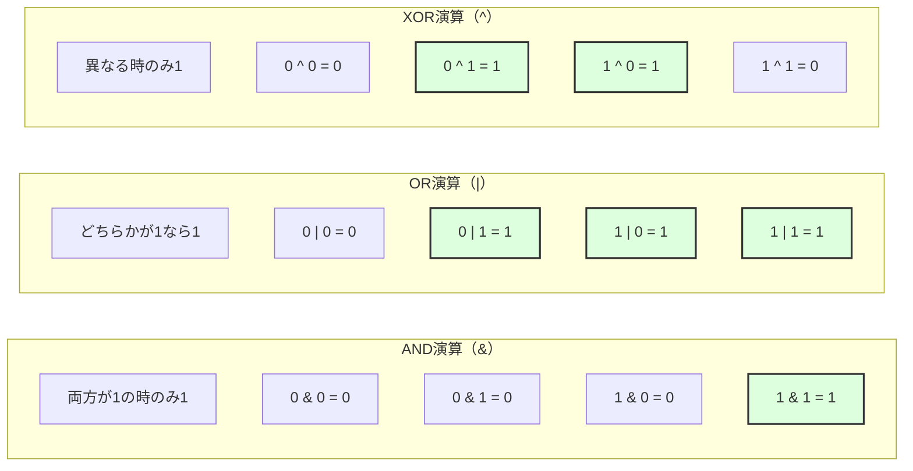

# ビット操作とビットフィールド

## 対応C規格

- **主要対象：** C90
- **学習内容：** ビット演算、ビットマスク、ビットフィールド、実践的なビット操作技術

## 学習目標

この章を完了すると、以下のことができるようになります。

- 符号なし整数にビット演算子を適用できる
- ビットマスクを使ったフラグ管理ができる
- ビットフィールドを理解して活用できる
- シフト演算の定義域を説明できる
- ビットフィールドの移植性上の制約を説明できる

## 概要と詳細

### ビット操作とは

コンピュータの内部では、数字も文字も画像も、すべて`0`と`1`の並びで表されています。
この`0`か`1`の1桁のことを**ビット（bit）**と呼びます。
電球のスイッチがずらっと並んでいて、`0`がOFF、`1`がONだとイメージするとわかりやすいでしょう。
スイッチが8個（8ビット）集まると**1バイト（byte）**になります。

**ビット操作**とは、整数の中に並んでいる`0`と`1`のスイッチを、1つずつ直接ONにしたりOFFにしたり、左右にずらしたりする処理のことです。
たとえば、ゲームの「ポーズ中」「ゲームオーバー」などのON/OFFの状態（**フラグ**と呼びます）を1つの整数にまとめて保存したり、通信データや電子機器の決まったビット位置を読み書きしたりするときに使います。

ビット操作では、原則として**符号なし整数型**（`unsigned int`や`unsigned char`など）を使います。
通常の符号付き整数型（`int`など）では、一番左のビットがプラス・マイナスの符号を表すために使われるため、ビットを動かしたときの結果が環境によって変わることがあるからです。
符号なし整数型ならすべてのビットが純粋な数値として扱われるため、計算結果を予測しやすくなります。

### ビット演算子の詳細

C言語には、ビットを直接操作するための専用の演算子（**ビット演算子**）が6種類用意されています。
2つの数の同じ位置にあるビット同士を比べる演算子と、ビットの並びを丸ごと動かす演算子があります。

#### ビット演算子一覧

| 演算子 | 名称 | 動作 | 使用例 |
| --- | --- | --- | --- |
| `&` | AND（論理積） | 両方が1のとき1 | `a & b` |
| `\|` | OR（論理和） | どちらかが1なら1 | `a \| b` |
| `^` | XOR（排他的論理和） | 異なるとき1 | `a ^ b` |
| `~` | NOT（ビット反転） | 0と1を入れ替える | `~a` |
| `<<` | 左シフト | ビットを左へ移動 | `a << 2` |
| `>>` | 右シフト | ビットを右へ移動 | `a >> 2` |

それぞれの動きをスイッチにたとえると、次のようになります。

- **`&`（AND）**：2つのスイッチが両方ともON（`1`）のときだけ`1`になり、必要なビットだけを取り出すときに使います
- **`|`（OR）**：2つのスイッチのどちらか一方でもON（`1`）なら`1`になり、特定のビットをONにするときに使います
- **`^`（XOR）**：2つのスイッチの状態が違うとき（片方が`0`で片方が`1`）だけ`1`になり、特定のビットを反転させるときに使います
- **`~`（NOT）**：すべてのビットの`0`と`1`をひっくり返します
- **`<<`（左シフト）**：ビットの並びを丸ごと左へずらして空いた右端に`0`を入れ、符号なし整数では1ビット左へずらすごとに値が2倍になります（桁があふれない範囲）
- **`>>`（右シフト）**：ビットの並びを丸ごと右へずらし、符号なし整数では空いた左端に`0`が入って1ビット右へずらすごとに値が半分（小数点以下切り捨て）になります

#### ビット演算の真理値表

`&`、`|`、`^`の3つの演算について、`0`と`1`の全パターンをまとめた表を**真理値表**と呼びます。
緑色で塗られているのが、結果が`1`になる組み合わせです。



### ビットマスクの活用

#### ビットマスクとは

**ビットマスク**とは、特定のビットだけを狙って操作したり調べたりするために用意する「型紙（かたがみ）」のようなビットのパターンです。
たとえば、8個のスイッチの中から「右から4番目（ビット3）だけ」を操作したいとき、ビット3だけが`1`で残りがすべて`0`の数値を用意しておくと便利です。

C言語では、ビットの位置を右端から0番目、1番目、2番目……と数えます。
また、コード中に出てくる`0x01`や`0x10`は**16進数**という書き方です。
先頭に`0x`を付けて表し、16進数の1桁がちょうど2進数の4ビットに対応するため、ビットの並びを確認しやすくなります。

```c
/* 基本的なビットマスク */
#define BIT0 0x01  /* 00000001 */
#define BIT1 0x02  /* 00000010 */
#define BIT2 0x04  /* 00000100 */
#define BIT3 0x08  /* 00001000 */
#define BIT4 0x10  /* 00010000 */
#define BIT5 0x20  /* 00100000 */
#define BIT6 0x40  /* 01000000 */
#define BIT7 0x80  /* 10000000 */
```

#### ビット操作の基本テクニック

ビットマスクとビット演算子を組み合わせると、「ONにする」「OFFにする」「反転させる」「調べる」の4つの基本操作ができます。
ここでは、8ビットの変数`flags`のビット3（`BIT3`＝`00001000`）を操作する例を見ていきます。

##### 1. 特定ビットのセット（1にする）

OR演算子（`|`）は、相手のビットが`1`なら必ず`1`、相手が`0`なら元の値のままという性質があります。
そのため、`flags |= BIT3`と書くことで、他のビットを変えずにビット3だけを`1`（ON）にできます。

```c
unsigned char flags = 0x00;
flags |= BIT3;  /* ビット3を1にセット */
/* flags = 00001000 */
```

##### 2. 特定ビットのクリア（0にする）

特定のビットだけを`0`（OFF）にしたいときは、`~`（反転）と`&`（AND）を組み合わせます。
まず`~BIT3`でビット3だけが`0`で他がすべて`1`のマスク（`11110111`）を作ります。
それと`flags`をAND演算すると、ビット3は必ず`0`になり、他のビットは`1`とANDされるため元の値のまま残ります。

```c
flags &= ~BIT3;  /* ビット3を0にクリア */
/* flags = 00000000 */
```

##### 3. 特定ビットの反転（トグル）

XOR演算子（`^`）は、相手が`1`だと元のビットを反転させ、相手が`0`だと元のままにします。
照明のスイッチを1回押すたびにONとOFFが切り替わるように、ビット3を反転させたいときは`^=`を使います。

```c
flags ^= BIT3;  /* ビット3を反転 */
/* 0なら1に、1なら0に */
```

##### 4. 特定ビットのテスト

特定のビットが今`1`かどうかを調べたいときは、AND演算子（`&`）を使います。
`flags & BIT3`を計算すると、ビット3以外の位置はすべて`0`になります。
ビット3が`1`なら結果は`00001000`（0以外＝真）、ビット3が`0`なら結果は`00000000`（0＝偽）になるため、そのまま`if`文の条件に使えます。

```c
if (flags & BIT3) {
    /* ビット3が1の場合 */
}
```

### フラグ管理システム

#### 実用的なフラグシステムの例

ON/OFFの目印（フラグ）がたくさんある場合、それぞれに`int`型の変数を作るとメモリを多く使ってしまいます。
ビットマスクを使えば、1バイト（`unsigned char`）の中に最大8個ものフラグをまとめて管理できます。

次の例では、ファイルの「読み込み・書き込み・実行」の権限や、ゲームの状態をビットマスクで定義しています。
`PERM_READ | PERM_WRITE`のように複数のマスクをORでつなぐと、複数のフラグを一度にONにできます。

```c
/* ファイルアクセス権限 */
#define PERM_READ    0x04  /* 100 */
#define PERM_WRITE   0x02  /* 010 */
#define PERM_EXECUTE 0x01  /* 001 */

/* ゲームの状態フラグ */
#define STATE_RUNNING   0x01
#define STATE_PAUSED    0x02
#define STATE_GAMEOVER  0x04
#define STATE_DEBUG     0x08

/* 使用例 */
unsigned char permissions = 0;
permissions |= PERM_READ | PERM_WRITE;  /* 読み書き権限を付与 */

if (permissions & PERM_WRITE) {
    /* 書き込み権限がある場合の処理 */
}
```

`permissions |= PERM_READ | PERM_WRITE;`を実行すると、`permissions`は`00000110`になります。
その後の`if (permissions & PERM_WRITE)`ではビット1が`1`なので条件が成り立ち、書き込み権限があるときの処理が実行されます。

### 効率的なビット操作アルゴリズム

ビット演算の性質をうまく使うと、ちょっとした計算をとても少ない手順でこなすことができます。
ここでは代表的な3つのテクニックを紹介します。

#### 1. ビットカウント（1の個数を数える）

整数の中に`1`のビットが何個入っているかを数えるアルゴリズムです。
鍵となるのは`n & (n - 1)`という式で、これを計算すると**一番右にある`1`のビットだけが`0`に消える**という面白い性質があります。

たとえば`n`が`12`（2進数で`1100`）のとき、`n - 1`は`11`（`1011`）です。
`1100 & 1011`を計算すると`1000`になり、右から3番目の`1`が消えました。
次のループでは`1000 & 0111`で`0000`になり、ループが終了します。
`1`の個数と同じ回数（2回）だけループすれば数え終わるため、全ビットを1つずつ調べるより効率的です。

```c
/* Brian Kernighanのアルゴリズム */
int count_bits(unsigned int n) {
    int count = 0;
    while (n) {
        n &= (n - 1);  /* 最下位の1を消す */
        count++;
    }
    return count;
}
```

#### 2. 2のべき乗判定

`1`、`2`、`4`、`8`、`16`……のように、2を何回か掛けた数（2のべき乗）かどうかを判定する関数です。
2進数で書くと、`1`（`0001`）、`2`（`0010`）、`4`（`0100`）、`8`（`1000`）のように、**2のべき乗は`1`のビットがちょうど1個だけ**という特徴があります。

そのため、`n & (n - 1)`で一番右の`1`を消したときに結果が`0`になれば、`1`は1個しかなかったとわかります。
ただし`n`が`0`のときも`0 & (0 - 1)`は`0`になってしまうため、先頭に`n &&`を付けて「`n`が0ではないこと」も同時に確認しています。

```c
int is_power_of_two(unsigned int n) {
    return n && !(n & (n - 1));
}
```

#### 3. ビットスワップ

通常、2つの変数の値を入れ替えるには一時的な変数（`temp`など）を使いますが、XORを3回使うと一時変数なしで値を交換できます。
同じ数で2回XORすると元に戻る（`x ^ y ^ y == x`）という性質を利用しています。

```c
/* XORを使った値の交換 */
void swap_without_temp(int *a, int *b) {
    if (a == b) {
        return;
    }
    *a ^= *b;
    *b ^= *a;
    *a ^= *b;
}
```

同じオブジェクト（同じ場所の変数）へのポインターを2つ渡すと、最初の`*a ^= *b;`で同じ値同士のXORになって値が`0`に消えてしまいます。
そのため、事前に`a == b`を検査して何もしないようにしています。
実際のプログラムでは、一時変数を使う普通の交換方法の方が、同じ変数を渡したときの落とし穴もなく、読んだ人にも意図がはっきり伝わるためおすすめです。

### ビットフィールド

#### ビットフィールドとは

**ビットフィールド**は、構造体のメンバに対して「このメンバは1ビットだけ」「このメンバは6ビットだけ」のように、ビット単位でサイズを指定できる機能です。
普通の構造体では小さなフラグ1つにも`int`型（通常32ビット）などを使ってしまいますが、ビットフィールドを使うと1つの箱の中を細かく仕切って、複数の値をぎゅっと詰め込めます。

#### 基本的な宣言

メンバ名の後ろに`: ビット数`と書いて宣言します。
次の例では、`1 + 1 + 6 + 4 + 4 = 16`ビット分のメンバをまとめて定義しています。

```c
struct PackedData {
    unsigned int flag1 : 1;   /* 1ビット */
    unsigned int flag2 : 1;   /* 1ビット */
    unsigned int value : 6;   /* 6ビット */
    unsigned int type  : 4;   /* 4ビット */
    unsigned int reserved : 4; /* 4ビット（予約） */
};
```

#### ビットフィールドの使用例

日付データを例に考えてみましょう。
「日（1〜31）」は5ビットあれば表せます（5ビットで表せるのは0〜31の32通り）。
「月（1〜12）」は4ビット（0〜15）、「2000年からの経過年（0〜127）」は7ビット（0〜127）で十分です。
合計16ビット（2バイト）に収まるため、通常の`int`型3つ（合計12バイト程度）よりずっとコンパクトになります。

```c
#include <stdio.h>

/* 日付を圧縮して格納 */
struct Date {
    unsigned int day   : 5;  /* 1-31 (5ビット) */
    unsigned int month : 4;  /* 1-12 (4ビット) */
    unsigned int year  : 7;  /* 0-127 (7ビット) 2000年からのオフセット */
};

int main(void) {
    struct Date today = {15, 12, 24};  /* 2024年12月15日 */

    printf("Date: %u-%u-%u\n",
           2000 + today.year, today.month, today.day);
    printf("Size: %lu bytes\n", (unsigned long)sizeof(struct Date));

    return 0;
}
```

使い方は普通の構造体とほとんど同じで、`today.year`や`today.month`のようにドット演算子で読み書きできます。
なお、`sizeof(struct Date)`の結果は、コンピュータがメモリを区切りよく扱うためのすき間（**パディング**）が入るため、多くの環境では4バイトになります。

#### ハードウェアレジスタを表す場合の制約

マイコン（小型コンピュータ）などの電子機器を制御する**ハードウェアレジスタ**（機器の設定スイッチが並んだ特別なメモリ領域）は、ビットごとに役割が決まっています。
一見すると、次のようにビットフィールドで書くと便利そうに見えます。

```c
/* マイコンのレジスタ定義例 */
struct ControlRegister {
    unsigned int enable     : 1;   /* ビット0: 有効/無効 */
    unsigned int interrupt  : 1;   /* ビット1: 割り込み許可 */
    unsigned int mode       : 2;   /* ビット2-3: 動作モード */
    unsigned int speed      : 3;   /* ビット4-6: 速度設定 */
    unsigned int reserved   : 1;   /* ビット7: 予約 */
};
```

しかし、ビットフィールドをメモリ上の右から並べるか左から並べるか、どこで区切るかは**処理系定義**（コンパイラやCPUの種類によって決められるルール）です。
特定のビット配置を要求するハードウェアレジスタへこの構造体をそのまま重ねられるかどうかは、対象となる環境の**ABI**（プログラムや機器同士でデータの配置方法を取り決めた約束事）とコンパイラの仕様を確認する必要があります。
別のコンピュータやコンパイラでも確実に同じように動くコード（**移植性**の高いコード）を書きたい場合は、ビットフィールドではなく、符号なし整数値とビットマスクを使って各ビットを読み書きします。

### ビットフィールドの注意点

ビットフィールドには、普通の構造体メンバとは違うルールや制限があります。

#### 1. 移植性の問題

別の種類のコンピュータやコンパイラにコードを持っていったとき、ビットの並び方が変わってしまうことがあります。

- ビットフィールドのメモリ上の配置（レイアウト）はコンパイラや環境によって異なる
- **エンディアン**（複数バイトのデータを大きい位から並べるか、小さい位から並べるかの方式）の影響を受ける
- **パディング**（メモリを扱いやすい区切りにそろえるためのすき間）が入る位置が異なる場合がある

#### 2. アドレスが取得できない

メモリ上の番地（アドレス）は1バイト単位で割り当てられています。
ビットフィールドは1バイトより小さいビット単位で配置されるため、`&`演算子でアドレスを取り出すことはできません。

```c
struct BitField {
    unsigned int flag : 1;
};

struct BitField bf;
/* &bf.flag は制約違反：ビットフィールドのアドレスは取得できない */
```

#### 3. 配列にできない

ビットフィールドのメンバを配列として宣言することも、C言語のルールで禁止されています。

```c
struct Invalid {
    unsigned int flags[8] : 1;  /* 制約違反：配列をビットフィールドにはできない */
};
```

### 実践的な応用例

ビット操作は、実際のゲーム開発や画像処理、インターネット通信などでも広く使われています。

#### RGB565形式の色操作

画面の色は、赤（Red）・緑（Green）・青（Blue）の3色の強さを混ぜて作ります。
ゲーム機や小型ディスプレイなどメモリを節約したい環境では、1つの点の色を16ビット（2バイト）に収める**RGB565形式**がよく使われます。
赤に5ビット、緑に6ビット、青に5ビットを割り当てます（人間の目は緑の違いに敏感なため、緑だけ1ビット多くなっています）。

次の`make_rgb565`関数では、3つの数値をビットマスクとシフトで1つの16ビット値にまとめています。
まず`r & 0x1F`で赤の下位5ビットだけを取り出して11ビット左にずらし、次に`g & 0x3F`で緑の6ビットを取り出して5ビット左にずらし、最後に青の5ビットとOR（`|`）で合体させています。

```c
/* 16ビットRGB（5-6-5形式） */
typedef struct {
    unsigned int blue  : 5;
    unsigned int green : 6;
    unsigned int red   : 5;
} RGB565;

/* または単一の16ビット値として */
#define RGB565_RED_MASK   0xF800  /* 11111000 00000000 */
#define RGB565_GREEN_MASK 0x07E0  /* 00000111 11100000 */
#define RGB565_BLUE_MASK  0x001F  /* 00000000 00011111 */

unsigned short make_rgb565(int r, int g, int b) {
    return ((r & 0x1F) << 11) | ((g & 0x3F) << 5) | (b & 0x1F);
}
```

#### ネットワークプロトコルのヘッダ

インターネットでデータを送るときは、データの先頭に「バージョン」「種類」「データサイズ」などをまとめた**ヘッダ**（宅配便の送り状のような情報）を付けます。

```c
/* 論理上のフィールドを表す例。送受信バイト列へ直接重ねない */
struct PacketHeader {
    unsigned int version  : 4;   /* プロトコルバージョン */
    unsigned int type     : 4;   /* パケットタイプ */
    unsigned int flags    : 8;   /* 各種フラグ */
    unsigned int length   : 16;  /* データ長 */
};
```

ネットワーク上の通信ルール（プロトコル）では、ビットの順番やバイトの順番、すき間の有無が厳密に決められています。
そのため、実際の送受信ではビットフィールドのメモリ配置にそのまま頼らず、ビットマスクとシフトを使って決まった順番のバイト列へ変換（**直列化**）してから送受信します。

### ビット操作のベストプラクティス

安全で読みやすいビット操作のコードを書くためのコツを3つ紹介します。

#### 1. マクロの活用

ビットをセットしたりクリアしたりする式を毎回手書きすると、間違いやすくなります。
次のように`#define`でマクロ（よく使う式に名前を付けたもの）にしておくと、プログラムの意図がひと目でわかります。
`1U`の`U`は「符号なし整数（`unsigned int`）の1」という意味です。

```c
#define SET_BIT(value, bit)    ((value) |= (1U << (bit)))
#define CLEAR_BIT(value, bit)  ((value) &= ~(1U << (bit)))
#define TOGGLE_BIT(value, bit) ((value) ^= (1U << (bit)))
#define TEST_BIT(value, bit)   ((value) & (1U << (bit)))
```

`bit`には0以上かつ`unsigned int`型のビット幅未満の値を指定する必要があります（32ビット環境なら0〜31）。
この範囲を外れたシフトを行うと**未定義動作**（C言語のルール違反で、プログラムがどんな動きをするか保証されない危険な状態）になります。

#### 2. 型の明確化

ビット操作に使う変数は、はじめから`unsigned int`や`unsigned char`などの符号なし型で宣言しておきます。

```c
/* 符号なし型を使用してシフトの動作を明確に */
unsigned int flags = 0;
unsigned char byte_data = 0xFF;
```

#### 3. 定数の使用

コードの中に`32`や`0xFF`のような生の数字（意味がわかりにくい数字を**マジックナンバー**と呼びます）をそのまま書かず、名前を付けた定数にしておくと読みやすくなります。

```c
/* マジックナンバーを避ける */
#define MAX_FLAGS 32
#define BYTE_MASK 0xFF
#define NIBBLE_MASK 0x0F
```

### よくある間違いとデバッグ

ビット操作でつまずきやすい3つの落とし穴を確認しておきましょう。

#### 1. 符号付き整数の右シフト

マイナスの値が入った符号付き整数を右シフトしたとき、空いた左端に`1`が入るか`0`が入るかは環境（処理系）によって異なります。
予想外の結果を防ぐため、シフト演算は符号なし整数型で行いましょう。

```c
int negative = -16;
int result = negative >> 2;
/* 負の符号付き整数の右シフト結果は処理系定義 */
```

#### 2. シフト量の範囲外

変数のビット幅と同じ数、またはそれ以上の回数だけシフトすると未定義動作になります。
たとえば32ビットの`unsigned int`型を32ビット以上シフトしてはいけません。
また、シフト量にマイナスの数を指定するのも未定義動作です。

```c
unsigned int value = 1;
value <<= 32;  /* unsigned intが32ビットなら未定義動作 */
```

#### 3. 演算子の優先順位

C言語では、`==`や`!=`の方が`&`や`|`よりも先に計算されます。
そのため、`if (flags & BIT0 == 0)`と書くと`flags & (BIT0 == 0)`と解釈されてしまい、思っていた通りに動きません。
ビット演算の結果を比較するときは、必ず丸括弧`()`で囲みましょう。

```c
/* 間違い */
if (flags & BIT0 == 0)  /* ==が先に評価される */

/* 正しい */
if ((flags & BIT0) == 0)
```

## 実例コード

完全な実装例は以下のファイルを参照してください。

### ビット操作の基本

- [bit_basics.c](examples/bit_basics.c) - C90準拠版
- [bit_basics_c99.c](examples/bit_basics_c99.c) - C99準拠版

### ビットフィールドの活用

- [bitfield_examples.c](examples/bitfield_examples.c) - C90準拠版
- [bitfield_examples_c99.c](examples/bitfield_examples_c99.c) - C99準拠版

### 実践的な応用

- [bit_applications.c](examples/bit_applications.c) - C90準拠版
- [bit_applications_c99.c](examples/bit_applications_c99.c) - C99準拠版

## 学習のポイント

1. **符号なし型**：ビット演算では、値の表現とシフト結果を予測しやすい符号なし整数型を使います
2. **シフト量**：右側のシフト量が負の数、または左側の変数のビット幅以上だと未定義動作になります
3. **ビットマスク**：操作するビットだけを1にしたマスクで、セット、クリア、反転、検査を行います
4. **ビットフィールド**：メモリ配置を外部形式やハードウェア制御にそのまま利用する場合は、処理系の仕様を確認します

## 次の章へ

次の[構造体とポインター](../structures/README.md)では、ビットフィールドを含む構造体のサイズと配置を扱います。

## 参考資料

- [ビット演算](https://en.cppreference.com/w/c/language/operator_arithmetic)
- [ビットフィールド](https://en.cppreference.com/w/c/language/struct)

## 演習問題

[演習問題](exercises/)では、マスク、シフト量、符号なし整数、ビットフィールドの制約を確認できます。

- 基礎問題：基本的な文法や概念の確認
- 応用問題：より実践的なプログラムの作成
- チャレンジ問題：高度な理解と実装力が必要な問題
