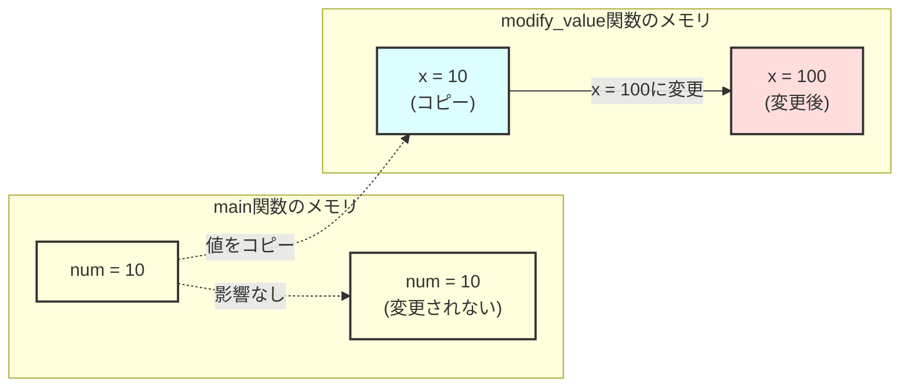
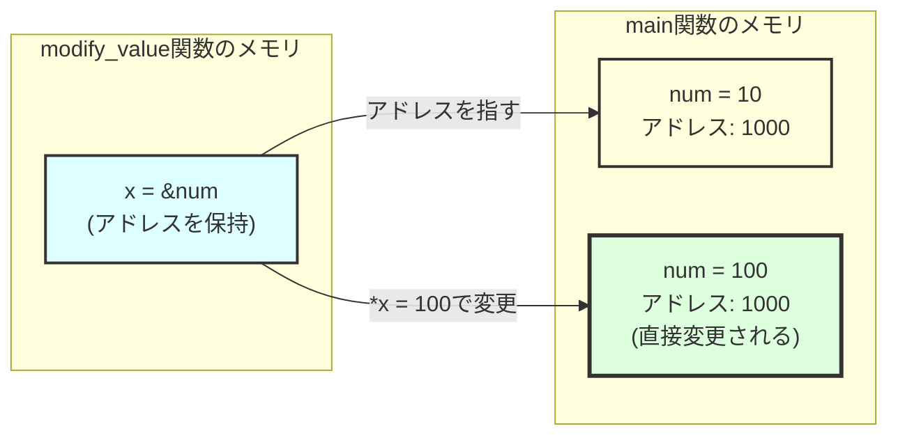
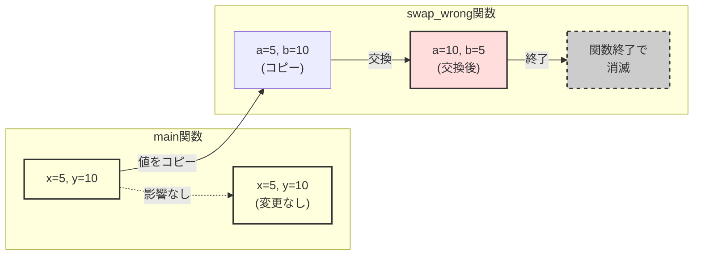
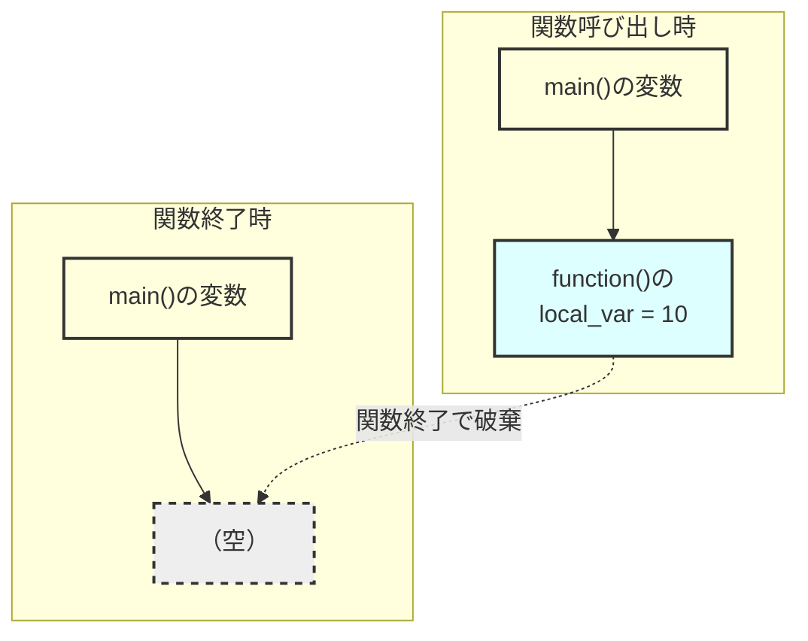

# 関数

## 対応C規格

- **主要対象：** C90
- **学習内容：** 関数の基本、引数と戻り値、関数のスコープ、再帰関数、関数プロトタイプ

## 学習目標

この章を完了すると、以下のことができるようになります。

- 関数の定義と呼び出しができる
- 引数と戻り値を適切に使える
- 関数のスコープを理解する
- 再帰関数を作成できる
- 関数プロトタイプの重要性を理解する

## 概要と詳細

### 関数とは

関数は、プログラムを「部品」に分けるための仕組みです。
料理でいえば「野菜を切る」「スープを煮る」のように、決まった作業を1つのまとまりにして名前を付けたものが関数です。
大きなプログラムをそのまま1か所に全部書くと長くて読みにくくなりますが、機能ごとに小さな部品へ分けると整理しやすくなります。
このように大きな問題を小さな部分に分けて解決する考え方を「分割統治」と呼びます。

### 関数の基本概念

関数は、名前を付けた処理の単位です。
自動販売機をイメージすると分かりやすいでしょう。
お金（入力）を入れてボタンを押すと、ジュース（結果）が出てきます。
関数も同じように、処理に必要なデータを**仮引数（かりひきすう）**という受け口で受け取り、計算や処理が終わったら必要に応じて**戻り値（もどりち）**という結果を返します。
処理を関数へ分けると、同じ処理を何度でも使い回せるようになり、ミスを直したり動作をテストしたりする範囲も小さく絞れます。

#### 関数を使う理由

1. **再利用：** 同じ処理を複数の場所から何度でも呼び出せます
2. **分割：** 大きな処理を、入力と出力がはっきりした小さな単位へ分けられます
3. **保守：** バグを直したり動作を確かめたりする範囲を、関数単位で絞れます
4. **可読性：** 関数に分かりやすい名前を付けることで、何をしている処理なのか一目で分かります

#### 関数の構成要素

関数は次の形で書きます。

```c
戻り値の型 関数名(引数リスト)
{
    /* 関数本体 */
    return 戻り値;  /* 戻り値がある場合 */
}
```

それぞれの意味は次のとおりです。

- **戻り値の型：** 関数が返す結果のデータ型（`int`や`double`など、結果を返さないときは`void`）を書きます
- **関数名：** 関数を呼び出すときに使う名前で、処理の内容が分かる名前を付けます
- **引数リスト：** 関数が受け取るデータの型と名前をカンマ区切りで並べ、受け取るデータがないときは`void`と書きます
- **関数本体：** 波かっこ`{`から`}`の中に、実行したい処理を書きます
- **`return`文：** 計算結果などを呼び出し元へ返して、関数の実行を終わらせます

### 関数の定義と宣言

関数を使うには、「宣言」と「定義」の違いを理解しておく必要があります。
**宣言**は「こういう名前と形の関数がありますよ」と先に知らせることで、**定義**は関数の中身（実際の処理）を書くことです。

#### 関数プロトタイプが必要な理由

C言語のコードをコンピュータが動く形へ翻訳するソフトを**コンパイラ**と呼びます。
コンパイラは基本的にプログラムを上から下へ順番に読みます。
そのため、`main`関数の中で呼び出す関数が`main`関数より下に書かれていると、コンパイラはその関数の形（戻り値の型や引数の型）をまだ知らない状態で呼び出しを見ることになります。

そこで使うのが**関数プロトタイプ（前方宣言）**です。
関数プロトタイプは、関数の戻り値の型と仮引数の型を呼び出しより前にコンパイラへ知らせる「予告状」のような役割をします。
コンパイラはこの情報を使って、関数を呼び出すときに引数の個数や型が合っているかをチェックしてくれます。

#### 関数プロトタイプ（前方宣言）

関数プロトタイプは、関数の1行目だけを書いて最後にセミコロン`;`を付けます。

```c
/* 関数プロトタイプ */
int add(int a, int b);
void print_message(void);
```

1行目は「`int`型の値を2つ受け取り、`int`型の結果を返す`add`関数がある」と知らせています。
2行目は「引数を受け取らず、戻り値も返さない`print_message`関数がある」と知らせています。
`void`は「何もない」という意味の特別なキーワードです。

#### 関数の定義

関数の定義では、波かっこ`{}`の中に実際の処理を書きます。

```c
/* 関数の実装 */
int add(int a, int b)
{
    return a + b;
}

void print_message(void)
{
    printf("Hello, World!\n");
}
```

`add`関数は受け取った`a`と`b`を足し算して、その結果を`return`で返します。
`print_message`関数は画面に文字を表示するだけで結果を返さないため、`return`文は書いていません。

### 引数は常に値渡し

関数を呼び出すときに実際に渡す値のことを**実引数（じつひきすう）**、関数側で受け取る変数のことを**仮引数（かりひきすう）**と呼びます。
C言語の関数呼び出しでは、すべての実引数が**値渡し（あたいわたし）**されます。
値渡しとは、元の変数そのものではなく、中に入っている値の「コピー」を関数へ渡す仕組みです。

あとで学ぶ**ポインター**（変数の場所を表すデータ）を実引数にした場合も、関数が受け取るのはポインター値のコピーです。
ただし、コピーしたポインターを使って元の場所をたどる（これを**間接参照**と呼びます）と、呼び出し側の変数の値を書き換えることができます。

#### 値渡し（Call by Value）

整数などの値を関数へ渡すと、仮引数はその値のコピーで初期化されます。
テスト用紙をコピーして友達に渡すイメージを思い浮かべてみてください。
友達がコピー用紙に赤ペンで書き込んでも、自分の手元にある元のテスト用紙には何も書かれません。
同じように、関数の中で仮引数の値を変更しても、呼び出し側の元の変数にはまったく影響しません。

##### 値渡しのメカニズム

`main`関数の変数`num`を`modify_value`関数へ渡したときのメモリの動きを、図で確認しましょう。



##### 値渡しの実例

実際にコードで動きを確かめます。

```c
void modify_value(int x)
{
    printf("Inside before: x = %d\n", x);
    x = 100;  /* 元の変数には影響しない */
    printf("Inside after: x = %d\n", x);
}

int main(void)
{
    int num = 10;
    printf("Before call: num = %d\n", num);

    modify_value(num);

    printf("After call: num = %d\n", num);  /* 10のまま */
    return 0;
}
```

このプログラムでは、`modify_value(num)`を呼んだ瞬間に`num`の値`10`がコピーされて、`modify_value`関数の中の別の箱`x`に入ります。
関数の中で`x = 100;`と書き換えても、変わったのはコピーである`x`だけです。
そのため、`main`関数に戻って`num`を表示すると、最初の`10`のままになっています。

##### 値渡しの性質

値渡しでは、仮引数へ値を代入しても呼び出し側の変数（オブジェクト）を直接変更することはありません。
うっかり元のデータを壊してしまう心配がないため、安全に使えるのが長所です。

複数のデータを1つにまとめた**構造体**も値渡しできますが、データがとても大きい場合は、毎回まるごとコピーするのに時間とメモリがかかります。
また、関数から複数の計算結果を返したいときは、構造体を戻り値にするか、次の節で学ぶ「出力先を指すポインター」を渡して返します。

#### ポインター値を渡す場合

コンピュータの**メモリ**は、番号が付いたロッカーがたくさん並んでいるような場所です。
変数を作ると、どこかのロッカーに値がしまわれます。
このロッカー番号のことを**アドレス**と呼び、アドレスをしまっておく変数を**ポインター**と呼びます。

変数のアドレスを表すポインター値を関数へ渡すと、関数は「その番号のロッカーを開けて中身を読み書きする」ことができます。
このようにポインターが指す先のデータを操作することを**間接参照**と呼びます。
これは他の言語にある「参照渡し」という別の仕組みではなく、あくまで「ロッカー番号を書いたメモをコピーして渡す（ポインター値の値渡し）」という仕組みです。

##### ポインター値がコピーされる仕組み

`main`関数の変数`num`があるロッカー番号（アドレス）を`modify_value`関数へ渡したときの図です。



##### ポインターを使った変更例

ポインターを使って呼び出し側の変数を書き換えるコードです。

```c
void modify_value(int *x)
{
    printf("Inside before: *x = %d\n", *x);
    *x = 100;  /* 元の変数を変更 */
    printf("Inside after: *x = %d\n", *x);
}

int main(void)
{
    int num = 10;
    printf("Before call: num = %d\n", num);

    modify_value(&num);  /* &でアドレスを渡す */

    printf("After call: num = %d\n", num);  /* 100に変更されている */
    return 0;
}
```

ここでは2つの記号がポイントです。

- `&num`：`&`を付けると、変数`num`が入っているロッカー番号（アドレス）を取り出せます
- `*x`：仮引数`int *x`は「`int`型の変数のアドレスを受け取る箱」であり、関数の中で`*x = 100;`と書くと`x`に書かれた番号のロッカーを開けて中身を`100`に書き換えます

その結果、`main`関数に戻って`num`を表示すると、`100`に変わっています。

##### ポインターを渡す場合の性質

ポインターを使うと、呼び出し側の変数を変更したり、複数の出力先へ結果を書き込んだりできます。
一方で、関数側では「そのポインターが指す先に何個のデータがあるのか」「その変数はまだメモリ上に生きているのか」を型だけでは判断できません。
そのため、呼び出し側と関数側のあいだで、次のような約束事（契約）を決めてそろえておく必要があります。

- どのロッカーも指していない特別な値である`NULL`（ヌル）を渡してよいか
- 先頭から何要素ぶんまで安全に読み書きできるか
- 中身を書き換えてよいデータか、読むだけのデータか

#### 配列の引数渡し

同じ型のデータを横一列に並べた**配列**を関数へ渡すときは、少し特別なルールがあります。
配列を表す式を関数の引数に書くと、配列全体がコピーされるのではなく、通常は**先頭要素へのポインター**（1番目のロッカー番号）に変換されて渡されます。

##### 配列式と仮引数の型調整

次の例では、`numbers`という配列の中身をすべて2倍に書き換えています。

```c
void modify_array(int arr[], int size)
{
    int i;
    for (i = 0; i < size; i++) {
        arr[i] *= 2;  /* 元の配列を変更 */
    }
}

int main(void)
{
    int numbers[5] = {1, 2, 3, 4, 5};
    int i;

    printf("Before: ");
    for (i = 0; i < 5; i++) {
        printf("%d ", numbers[i]);
    }
    printf("\n");

    modify_array(numbers, 5);

    printf("After: ");
    for (i = 0; i < 5; i++) {
        printf("%d ", numbers[i]);  /* 値が2倍になっている */
    }
    printf("\n");

    return 0;
}
```

`modify_array(numbers, 5)`を呼ぶと、`numbers`の先頭アドレスと要素数の`5`が渡されます。
`arr[i] *= 2;`は先頭から`i`番目のロッカーの中身を2倍にする処理なので、`main`関数の`numbers`がそのまま書き換わります。

##### 関数が受け取る値

関数に渡されるイメージは次のとおりです。

```text
配列式は先頭要素へのポインターに変換される：

numbers[5] = {1, 2, 3, 4, 5}

numbers → [1][2][3][4][5]
          ↑
     先頭要素のアドレス

関数には、このポインター値のコピーが渡される
```

関数の仮引数に書いた`int arr[]`は、コンパイラによって`int *arr`と同じ意味に調整されます。
配列全体や要素数は一緒には渡されないため、関数が配列の終わりを超えて読み書きしないよう、要素数（この例では`size`）を別の引数で必ず渡します。

#### 構造体の引数渡し

**構造体**は、点のx座標とy座標のように、関連する複数のデータを1つの箱にまとめたものです。
構造体そのものを関数へ渡すと、構造体の中身がすべてコピーされます（値渡し）。
構造体へのポインターを渡すと、ポインター値（アドレス）だけがコピーされ、間接参照によって呼び出し側の構造体を直接操作できます。

##### 構造体の値渡し

`struct Point p`のように値渡しをすると、関数の中で`p.x`や`p.y`を変えても元の構造体は変わりません。
ドット`.`は、構造体の箱の中にあるメンバー（`x`や`y`）を取り出す記号です。

```c
struct Point {
    int x;
    int y;
};

void move_point(struct Point p)
{
    p.x += 10;  /* コピーを変更（元の構造体は変わらない） */
    p.y += 10;
}
```

##### 構造体へのポインターを渡す場合

`struct Point *p`のようにポインターを受け取ると、呼び出し側の構造体を直接変更できます。
ポインター経由で構造体のメンバーへアクセスするときは、ドット`.`ではなく矢印のような記号`->`（アロー演算子）を使います。

```c
void move_point_ref(struct Point *p)
{
    p->x += 10;  /* 元の構造体を変更 */
    p->y += 10;
}
```

#### ポインターを引数にする例

呼び出し側の変数を書き換えたいときや、1回の関数呼び出しで複数の結果を返したいときは、結果を書き込む先を指すポインターを引数にします。
よく使うパターンを順番に確認しましょう。

##### 1. swap関数（値の交換）

2つの変数の中身を入れ替える（スワップする）関数を考えてみます。
値渡しではコピーが入れ替わるだけで元の変数は変わらないため、それぞれの変数へのポインターを渡す必要があります。

```c
/* 値渡しでは交換できない（間違い例） */
void swap_wrong(int a, int b)
{
    int temp = a;
    a = b;
    b = temp;
    /* 関数内でコピーを交換しただけ */
}

/* 変数へのポインターを渡して交換 */
void swap_correct(int *a, int *b)
{
    int temp = *a;
    *a = *b;
    *b = temp;
}

int main(void)
{
    int x = 5, y = 10;

    printf("Before: x=%d, y=%d\n", x, y);

    swap_wrong(x, y);
    printf("After swap_wrong: x=%d, y=%d\n", x, y);  /* 5, 10のまま */

    swap_correct(&x, &y);
    printf("After swap_correct: x=%d, y=%d\n", x, y);  /* 10, 5に交換 */

    return 0;
}
```

`swap_correct`の中では、まず`temp`という一時的な避難用の変数に`*a`の値を入れておき、そのあとで`*a`に`*b`を移し、最後に`*b`へ`temp`の値を戻しています。
ジュースの入った2つのコップの中身を入れ替えるときに、空のコップをもう1つ用意するのと同じ考え方です。

**`swap_wrong`が呼び出し側を変更できない理由**

`swap_wrong`ではコピーされた`a`と`b`が交換されたあと、関数が終わるとそのコピーごと消えてしまうため、`main`関数の`x`と`y`は変わりません。



##### 2. 複数の値を返す関数

C言語の関数が`return`で直接返せる値は1つだけです。
しかし、結果を書き込む変数のアドレスを複数渡せば、それぞれの変数へ計算結果を書き込めます。
さらに`return`の戻り値として「成功したなら`0`、エラーならマイナスの数」を返すようにすると、エラー処理もきれいに書けます。

次の例では、割り算の「商」と「余り」を同時に求める関数と、配列の「最小値」「最大値」「平均値」を同時に求める関数を作っています。

```c
#include <limits.h>
#include <stddef.h>
#include <stdio.h>

/* 商と余りを出力引数へ書き込む */
int divide_with_remainder(int dividend, int divisor,
                          int *quotient, int *remainder)
{
    if (quotient == NULL || remainder == NULL) {
        return -1;
    }
    if (divisor == 0 || (dividend == INT_MIN && divisor == -1)) {
        return -2;
    }

    *quotient = dividend / divisor;
    *remainder = dividend % divisor;
    return 0;
}

/* 統計情報を一度に計算する */
int calculate_stats(const int arr[], int size,
                    int *min, int *max, double *average)
{
    int i;
    double sum = 0.0;

    if (size <= 0 || arr == NULL || min == NULL ||
        max == NULL || average == NULL) {
        return -1;
    }

    *min = *max = arr[0];

    for (i = 0; i < size; i++) {
        if (arr[i] < *min) *min = arr[i];
        if (arr[i] > *max) *max = arr[i];
        sum += arr[i];
    }

    *average = (double)sum / size;
    return 0;
}

int main(void)
{
    int q, r;
    int numbers[] = {23, 67, 12, 89, 45};
    int minimum, maximum;
    double avg;

    /* 除算の例 */
    if (divide_with_remainder(17, 5, &q, &r) == 0) {
        printf("17 / 5 = %d, remainder %d\n", q, r);  /* 3 余り 2 */
    }

    /* 統計計算の例 */
    if (calculate_stats(numbers, 5, &minimum, &maximum, &avg) == 0) {
        printf("Minimum: %d, maximum: %d, average: %.1f\n",
               minimum, maximum, avg);
    }

    return 0;
}
```

`divide_with_remainder`の中でチェックしている`dividend == INT_MIN && divisor == -1`は、`int`型の最小値を`-1`で割ると`int`型の最大値を超えてしまう（オーバーフローする）のを防ぐための安全チェックです。
また、`calculate_stats`では`arr`に`const`を付けて、関数の中で配列の中身をうっかり書き換えないように守っています。

##### 3. ポインター引数の検証とエラー処理

ポインターが`NULL`（どのアドレスも指していない状態）のまま`*ptr`のように間接参照してしまうと、プログラムが突然強制終了するなどの重大な問題（**未定義動作**）が起きます。
そのため、`NULL`を受け取る可能性がある関数では、間接参照の前に必ず`NULL`かどうかをチェックします。
もし「この関数に`NULL`は渡してはいけない」というルールにする場合は、関数の説明書やコメントなどで使う人にその条件をはっきり伝えます。

```c
#include <limits.h>

/* 基本的なNULLチェック */
void safe_increment(int *ptr)
{
    if (ptr != NULL) {  /* NULLポインターチェック */
        (*ptr)++;
    }
}

/* より実践的な例：文字列の安全なコピー */
int safe_string_copy(char *dest, const char *src, int dest_size)
{
    int i;

    /* 引数の検証 */
    if (dest == NULL || src == NULL || dest_size <= 0) {
        return -1;  /* エラー */
    }

    /* 安全にコピー */
    for (i = 0; i < dest_size - 1 && src[i] != '\0'; i++) {
        dest[i] = src[i];
    }
    dest[i] = '\0';  /* null終端を保証 */

    return i;  /* コピーした文字数を返す */
}

/* エラーコードを返す関数の例 */
int safe_divide(int a, int b, int *result)
{
    if (result == NULL) {
        return -1;  /* 引数エラー */
    }

    if (b == 0 || (a == INT_MIN && b == -1)) {
        return -2;  /* ゼロ除算エラー */
    }

    *result = a / b;
    return 0;  /* 成功 */
}
```

このコードのポイントを見てみましょう。

- `safe_increment`では、`(*ptr)++`のように丸かっこを付けることで「`ptr`が指す先の値」を1増やします
- `safe_string_copy`では、コピー先の大きさ`dest_size`を超えないように`dest_size - 1`文字までコピーし、最後に文字列の終わりを示す目印である`'\0'`（ヌル文字）を必ず入れています
- `safe_divide`では、引数がおかしいときは`-1`、0で割ろうとしたときなどは`-2`、成功したときは`0`を返して呼び出し元へ結果を伝えています

##### 4. 大きなデータ構造の効率的な処理

構造体にたくさんのデータが入っていると、値渡しで毎回まるごとコピーするのに時間とメモリがかかります。
次の`StudentRecord`構造体のように、名前・ID・10個分の点数・GPA・住所などをまとめた大きな構造体は、ポインターで渡すほうが効率的です。
中身を読むだけで書き換えない関数では、`const`を付けて安全に保護します。

```c
/* 大きな構造体の例 */
struct StudentRecord {
    char name[50];
    char id[20];
    int scores[10];
    double gpa;
    char address[100];
};

/* 構造体の値を渡す */
void print_student_by_value(struct StudentRecord student)
{
    printf("Name: %s\n", student.name);
    printf("GPA: %.2f\n", student.gpa);
}

/* const修飾した構造体へのポインター値を渡す */
void print_student_by_reference(const struct StudentRecord *student)
{
    if (student == NULL) return;

    printf("Name: %s\n", student->name);
    printf("GPA: %.2f\n", student->gpa);
}

/* 構造体を変更する関数 */
void update_gpa(struct StudentRecord *student, double new_gpa)
{
    if (student == NULL) return;

    student->gpa = new_gpa;
    printf("Updated %s GPA to %.2f\n",
           student->name, new_gpa);
}
```

`print_student_by_value`は構造体全体をコピーしますが、`print_student_by_reference`はアドレス1個ぶんをコピーするだけなので軽く動きます。
また、`update_gpa`は`const`を付けないポインターを受け取ることで、`student->gpa`を新しい値へ書き換えています。

##### 5. 配列操作の実践例

配列を関数へ渡すときは、先頭要素のアドレスだけでは要素の数が分かりません。
そのため、配列を処理する関数には、配列の要素数やコピーする範囲も一緒に渡します。
また、配列の範囲外へうっかりアクセスしないよう、最初にサイズのチェックを入れておくと安全です。

```c
/* 配列の要素をすべて特定の値に設定 */
void fill_array(int arr[], int size, int value)
{
    int i;

    if (arr == NULL || size <= 0) return;

    for (i = 0; i < size; i++) {
        arr[i] = value;
    }
}

/* 2つの配列を比較 */
int compare_arrays(const int arr1[], const int arr2[], int size)
{
    int i;

    if (arr1 == NULL || arr2 == NULL || size <= 0) {
        return -1;  /* エラー */
    }

    for (i = 0; i < size; i++) {
        if (arr1[i] != arr2[i]) {
            return 0;  /* 異なる */
        }
    }

    return 1;  /* 同じ */
}

/* 配列の一部を別の配列にコピー */
int copy_array_range(int dest[], int dest_size,
                     const int src[], int src_size,
                     int start, int count)
{
    int i;

    if (dest == NULL || src == NULL || start < 0 || count < 0) return -1;
    if (start > src_size || count > src_size - start) return -1;
    if (count > dest_size) return -1;

    for (i = 0; i < count; i++) {
        dest[i] = src[start + i];
    }
    return 0;
}
```

`copy_array_range`では、`start + count > src_size`と直接足し算するのではなく、`count > src_size - start`と引き算の形にしています。
これは、もし`start`と`count`がとても大きな数だったときに足し算で桁あふれ（オーバーフロー）が起きるのを防ぐ工夫です。
なお、このコピー関数は、コピー元とコピー先のメモリ範囲が重ならないことを前提とします。

##### 6. 戻り値と出力引数の組み合わせ

「計算が成功したかどうか」を戻り値で返し、「計算結果そのもの」をポインターで渡された変数へ書き込む設計は、C言語でとてもよく使われます。
たとえば`"123"`という文字列を整数の`123`へ変換する関数を考えてみましょう。
もし変換結果だけを戻り値にすると、`"0"`を変換して`0`になったのか、変換に失敗してエラーの`0`が返ったのか見分けがつきません。
そこで、戻り値は「状態（成功なら`0`、失敗なら負の数）」専用にして、変換した整数はポインターの`result`へ書き込みます。

```c
#include <errno.h>
#include <limits.h>
#include <stdlib.h>

/* 文字列を整数に変換（エラーチェック付き） */
int string_to_int(const char *str, int *result)
{
    char *end;
    long value;

    if (str == NULL || result == NULL) {
        return -1;  /* 引数エラー */
    }

    errno = 0;
    value = strtol(str, &end, 10);
    if (end == str || *end != '\0' || errno == ERANGE ||
        value < INT_MIN || value > INT_MAX) {
        return -2;
    }

    *result = (int)value;
    return 0;  /* 成功 */
}

/* 使用例 */
int main(void)
{
    int num;
    int status;

    status = string_to_int("123", &num);
    if (status == 0) {
        printf("Converted: %d\n", num);
    } else {
        printf("Conversion failed: %d\n", status);
    }

    return 0;
}
```

この例で使っている標準ライブラリの仕組みを簡単に確認しておきます。

- `strtol`：文字列を10進数などの`long`型の整数へ変換する標準関数で、変換が止まった場所のアドレスを`end`へ入れてくれます
- `errno`と`ERANGE`：標準ライブラリがエラーの種類を記録する特別な変数が`errno`で、数が大きすぎる・小さすぎるときに`ERANGE`が記録されます
- `end == str || *end != '\0'`：1文字も数字がなかった場合や、`"123abc"`のように後ろに余計な文字が残っていた場合をエラーとしてはじきます

##### 7. 引数の型を選ぶ基準

関数を作るときに「値をそのまま渡すか、ポインターを渡すか」で迷ったら、次の基準で選びます。
なお、ここで出てくる**API**とは、関数を呼び出すときの名前・引数・戻り値などの使い方や約束事のことです。

**オブジェクトの値を直接渡す例：**

- 基本データ型（`int`、`char`、`float`、`double`など）
- サイズが小さく、コピーの手間が気にならない構造体
- 関数から呼び出し側の変数を変更する必要がない場合

**オブジェクトへのポインターを渡す例：**

- 大きな構造体や配列
- 1回の呼び出しで複数の値を返したい場合
- 呼び出し側の元の値を変更する必要がある場合
- 構造体のコピーを避けたい場合

**`const`修飾した型へのポインターを渡す例：**

- 大きなデータを読むだけで書き換えない場合
- 関数の中でうっかりデータを書き換えてしまうミスを防ぎたい場合
- 「この関数はデータを変更しませんよ」という意図をAPIを使う人へはっきり伝えたい場合

#### const修飾子による保護

ポインターを介して呼び出し側のデータを変更させたくない場合は、ポインターが指す型に`const`（定数・変更不可という意味の修飾子）を付けます。
`const`を付けておくと、もし関数の中でうっかり中身を書き換えるコードを書いてしまっても、コンパイラがエラーを出して教えてくれます。

```c
/* 配列の内容を変更しない関数 */
int array_sum(const int arr[], int size)
{
    int i, sum = 0;

    /* arr[i] = 0;  コンパイルエラー（constで保護） */

    for (i = 0; i < size; i++) {
        sum += arr[i];  /* 読み取りはOK */
    }

    return sum;
}
```

#### 引数渡しのベストプラクティス

データ型ごとの定番の渡し方をまとめます。

1. **基本データ型（`int`、`char`、`float`など）**

    - 通常は値渡しを使用します
    - 呼び出し側の値を変更したい場合は、その変数へのポインターを渡します

2. **配列**

    - 配列式は先頭要素へのポインターに変換されます
    - 関数の中で中身を変更しない場合は`const`を付けます

3. **構造体**

    - コピーのコストが小さい構造体：構造体の値を直接渡します
    - コピーを避けたい大きな構造体：構造体へのポインターを渡します
    - 変更しない場合：`const`修飾した型へのポインターを渡します

4. **文字列**

    - `char`配列または`char *`で渡します
    - 変更しない場合は`const`を付けます

### 様々な関数の種類

関数は、戻り値があるかないか、仮引数があるかないかによって書き方が変わります。
やりたい処理に合わせて適切な形を選びましょう。

#### 戻り値のない関数（void関数）

画面への表示だけを行うなど、計算結果を返す必要がない関数では、戻り値の型に`void`を書きます。

```c
void print_header(void)
{
    printf("====================\n");
    printf(" Program start\n");
    printf("====================\n");
}

void greet_user(char *name)
{
    printf("Hello, %s\n", name);
}
```

`print_header`は引数も戻り値もない関数です。
`greet_user`は名前（文字列）を受け取ってあいさつを表示しますが、戻り値は返しません。

#### 配列を扱う関数

配列の合計を求めたり、配列の中身を同じ値で埋めたりする関数です。
配列の先頭アドレスだけでは要素の数が分からないため、どちらも`size`を一緒に受け取っています。

```c
/* 配列の要素数を計算できないため、サイズを別途渡す必要がある */
int array_sum(int arr[], int size)
{
    int i, sum = 0;

    for (i = 0; i < size; i++)
    {
        sum += arr[i];
    }

    return sum;
}

/* 配列を初期化する関数 */
void initialize_array(int arr[], int size, int value)
{
    int i;

    for (i = 0; i < size; i++)
    {
        arr[i] = value;
    }
}
```

### 再帰関数

**再帰関数（さいきかんすう）**は、関数の中で自分自身を呼び出す関数です。
ロシアのマトリョーシカ人形をイメージしてみてください。
大きな人形を開けると少し小さい同じ形の人形が入っていて、それを繰り返して一番小さい人形にたどり着いたら終わりになります。
再帰関数もこれと同じように、大きな問題を「少し小さい同じ形の問題」に分けて自分自身へ任せ、一番小さな問題になったら答えを返します。

#### 再帰関数の例

再帰関数を書くときは、再帰を終わらせる**基底条件（きていじょうけん）**と、問題を小さくしながら自分を呼び出す**再帰呼び出し**の2つが必要です。
基底条件がないと、自分自身を永遠に呼び出し続けてプログラムが止まらなくなってしまいます。

次の`factorial`関数は、階乗（かいじょう、たとえば`4!`なら`4 × 3 × 2 × 1 = 24`）を計算します。
`n - 1`を渡して問題を小さくし、`n <= 1`になったら`1`を返して呼び出しを止めます。
たとえば`factorial(3)`を呼ぶと、`3 * factorial(2)`→`3 * 2 * factorial(1)`→`3 * 2 * 1`と順番に展開されて`6`が求まります。

2つ目の`fibonacci`関数は、前の2つの数を足して次の数を作る**フィボナッチ数列**（`0, 1, 1, 2, 3, 5, 8, ...`）の`n`番目を計算します。

```c
/* 階乗を計算する再帰関数 */
int factorial(int n)
{
    if (n <= 1) {
        return 1;  /* 基底条件 */
    }
    return n * factorial(n - 1);  /* 再帰呼び出し */
}

/* フィボナッチ数列を計算する再帰関数 */
int fibonacci(int n)
{
    if (n <= 0) {
        return 0;
    }
    if (n == 1) {
        return 1;
    }
    return fibonacci(n - 1) + fibonacci(n - 2);
}
```

#### 再帰関数の構成要素

再帰関数は次の3つの要素で成り立ちます。

1. **基底条件：** 再帰を終了させるゴール条件です
2. **再帰呼び出し：** 自分自身を呼び出す部分です
3. **問題の分割：** 元の問題をより小さな同じ形の問題へ分ける工夫です

### 関数のスコープと生存期間

変数には2つの大切な性質があります。
1つは、その変数の名前をソースコードのどこから見たり使ったりできるかを表す**スコープ（有効範囲）**です。
もう1つは、プログラムの実行中にその変数がメモリ上に作られてから消えるまでの時間を表す**記憶域期間（生存期間）**です。
この2つは似ていますが別の概念なので、区別して覚えておきましょう。

#### ローカル変数とグローバル変数

関数の中や、波かっこ`{}`で囲まれたまとまり（**ブロック**）の中で宣言した変数の多くは、そのブロックの中だけで見える**ブロックスコープ**を持ちます。
これを一般に**ローカル変数**と呼びます。

一方、どの関数の外にも書かずにファイルの先頭付近などで宣言した変数は、そのファイル全体から見える**ファイルスコープ**を持ちます。
これを一般に**グローバル変数**と呼びます。

#### ローカル変数の詳細

関数の中で宣言したローカル変数は、宣言した場所を含むブロックの中でだけ使えます。
通常のローカル変数は**自動記憶域期間**を持ちます。
これは、ブロックに入るときに自動でメモリ上に作られ、ブロックから抜けるときに自動で破棄される（消える）という性質です。

##### ローカル変数の特徴

次の例では、関数のブロックと、その中にある小さなブロックでそれぞれローカル変数を宣言しています。

```c
void function_example(void)
{
    int local_var = 10;  /* この関数内でのみ有効 */

    {  /* ブロックスコープ */
        int block_var = 20;  /* このブロック内でのみ有効 */
        printf("block_var = %d\n", block_var);
    }  /* block_varはここで破棄される */

    /* printf("%d\n", block_var); エラー：block_varは見えない */

}  /* local_varはここで破棄される */
```

`block_var`は内側の`{}`の中で作られたため、その`}`を抜けた時点で消えてしまい、外側からは使えません。
`local_var`は`function_example`関数が終わるときに消えます。

##### ローカル変数のメモリ配置

関数が呼び出されたときと終了したときのメモリの変化を図で見てみましょう。



##### 同名のローカル変数

別の関数の中であれば、まったく同じ名前のローカル変数を作ってもぶつかりません。
それぞれの関数ごとに別の箱として扱われるからです。

```c
void func1(void)
{
    int count = 0;  /* func1のcount */
    count++;
    printf("func1: count = %d\n", count);  /* 1 */
}

void func2(void)
{
    int count = 100;  /* func2のcount（func1とは別物） */
    count++;
    printf("func2: count = %d\n", count);  /* 101 */
}

int main(void)
{
    int count = 50;  /* mainのcount */

    func1();  /* func1のcountを使用 */
    func2();  /* func2のcountを使用 */

    printf("main: count = %d\n", count);  /* 50（変更されない） */
    return 0;
}
```

`func1`、`func2`、`main`の3つにそれぞれ`count`がありますが、お互いに独立しているため、`func1`や`func2`で`count`を増やしても`main`の`count`は`50`のままです。

#### グローバル変数の詳細

関数の外で宣言した変数はファイルスコープを持ち、プログラムの開始から終了までずっとメモリ上に残ります。

複数ファイルにまたがるプログラムでは、1つの`.c`ファイル（読み込むヘッダーも含む）を**翻訳単位**と呼びます。
普通のグローバル変数は**外部リンケージ**という性質を持ち、別の翻訳単位からも`extern`宣言を書けば同じ変数を参照できます。
一方、先頭に`static`を付けたグローバル変数は**内部リンケージ**という性質になり、その翻訳単位（そのファイル）の中だけで名前を使えるようになります。

##### グローバル変数の宣言と使用

グローバル変数は、同じファイル内のどの関数からでも読み書きできます。

```c
/* グローバル変数の宣言 */
int global_count = 0;      /* 初期化あり */
double global_rate;        /* 初期化なし（0.0になる） */
char global_message[100];  /* 初期化なし（全て0になる） */

void increment_counter(void)
{
    global_count++;  /* どの関数からでもアクセス可能 */
}

void print_counter(void)
{
    printf("Counter: %d\n", global_count);
}

int main(void)
{
    print_counter();     /* カウンター: 0 */
    increment_counter();
    increment_counter();
    print_counter();     /* カウンター: 2 */

    global_count = 10;   /* main関数からも変更可能 */
    print_counter();     /* カウンター: 10 */

    return 0;
}
```

`increment_counter`を2回呼ぶと、`main`や`print_counter`からも見えている`global_count`が`0`から`2`へ増えます。

##### グローバル変数の初期化

ローカル変数は初期値を書かないと中身が不定（ゴミの値）になりますが、グローバル変数は初期値を書かなくても自動的に`0`で初期化されます。
ただし、グローバル変数の初期値に使えるのはコンパイル時に値が決まる定数式だけで、関数の呼び出し結果で初期化することはできません。

```c
/* グローバル変数は自動的に0で初期化される */
int g_int;          /* 0 */
double g_double;    /* 0.0 */
char g_char;        /* '\0' */
int g_array[10];    /* すべて0 */

/* 明示的な初期化も可能 */
int g_initialized = 100;
char g_string[] = "Hello, Global!";

/* 関数呼び出しによる初期化はできない */
/* int g_value = get_value(); 定数式ではないため初期化できない */
```

#### 変数の可視性（スコープ）と名前の隠蔽

同じ名前の変数が外側と内側のスコープの両方にある場合、もっとも内側のスコープの変数が優先されます。
このとき外側の変数が一時的に見えなくなることを、**名前の隠蔽（いんぺい）**と呼びます。

```c
int value = 100;  /* グローバル変数 */

void test_scope(void)
{
    printf("1: value = %d\n", value);  /* 100（グローバル） */

    {
        int value = 200;  /* グローバル変数を隠蔽 */
        printf("2: value = %d\n", value);  /* 200 */

        {
            int value = 300;  /* 外側のブロックの変数を隠蔽 */
            printf("3: value = %d\n", value);  /* 300 */
        }

        printf("4: value = %d\n", value);  /* 200 */
    }
}

int main(void)
{
    test_scope();
    printf("5: value = %d\n", value);  /* 100（グローバル） */
    return 0;
}
```

内側のブロックに入ると新しい`value`が見え、ブロックを抜けるとまた外側の`value`が見えるようになります。
ただし、同じ名前を重ねると読み間違えやすいので、実際のプログラムではなるべく別の名前を付けるのがおすすめです。

#### グローバル変数の問題点と対策

グローバル変数はどこからでも使えて便利に見えますが、使いすぎるとバグの原因になります。
代表的な3つの問題点と、安全な書き方を見ておきましょう。

##### 1. 予期しない変更

どこからでも書き換えられるため、ある関数を呼んだつもりなのに別の場所で使っていた値が勝手に変わってしまうことがあります。
引数と戻り値を使う設計にすると、どの値がどこへ流れているかがはっきりします。

```c
int total_score = 0;  /* グローバル変数 */

void add_score(int points)
{
    total_score += points;
}

void reset_score(void)
{
    total_score = 0;  /* 他の処理が共有している状態も変更する */
}

/* より良い設計：引数と戻り値を使用 */
int add_score_safe(int current_score, int points)
{
    return current_score + points;
}
```

##### 2. デバッグの困難さ

グローバル変数だらけのプログラムでは、計算結果がおかしくなったときに「どの関数が変な値を入れたのか」を調べる（**デバッグ**する）のがとても大変になります。
必要な値は引数で受け取り、結果を戻り値で返すようにすると、関数単体で動作を確かめやすくなります。

```c
/* 悪い例：グローバル変数を多用 */
int g_width, g_height, g_area;

void calculate_area(void)
{
    g_area = g_width * g_height;
}

/* 良い例：引数と戻り値を使用 */
int calculate_area_safe(int width, int height)
{
    return width * height;
}
```

##### 3. 名前の衝突

複数の`.c`ファイルを合体させて1つのプログラムを作るとき（これを**リンク**と呼びます）、別々のファイルで同じ名前のグローバル変数を定義していると、名前がぶつかってリンクに失敗します。
他のファイルから使う必要がない変数には`static`を付けて、そのファイルの中だけに閉じ込めておきます。

```c
/* file1.c */
int counter = 0;  /* グローバル変数 */

/* file2.c */
int counter = 0;  /* 同じ外部名の定義が重複し、リンクに失敗する */

/* 対策：staticを使用してファイルスコープに限定 */
static int counter = 0;  /* このファイル内でのみ有効 */
```

#### ローカル変数とグローバル変数の使い分け

##### ローカル変数を使うべき場合（推奨）

計算の途中で使う変数やループのカウンタなど、関数の中だけで完結するものはすべてローカル変数にします。

```c
/* 関数内で完結する処理 */
double calculate_average(int arr[], int size)
{
    int i;
    int sum = 0;  /* ローカル変数 */

    for (i = 0; i < size; i++) {
        sum += arr[i];
    }

    return (double)sum / size;
}

/* 一時的な計算 */
void print_multiplication_table(int n)
{
    int i, j;  /* ループカウンタはローカル変数 */

    for (i = 1; i <= n; i++) {
        for (j = 1; j <= n; j++) {
            printf("%4d", i * j);
        }
        printf("\n");
    }
}
```

##### グローバル変数が適切な場合（限定的）

円周率のようなプログラム全体で共通の定数や、デバッグ出力のオン・オフを切り替える設定値など、本当に全体で共有したいものにだけ限定して使います。

```c
/* 設定値やフラグ */
int debug_mode = 0;  /* デバッグモードのフラグ */
const double PI = 3.14159265359;  /* 定数 */

/* プログラム全体の状態 */
char program_name[256] = "MyApplication";
int error_count = 0;

void enable_debug(void)
{
    debug_mode = 1;
}

void log_message(const char *msg)
{
    if (debug_mode) {
        printf("[DEBUG] %s\n", msg);
    }
}
```

#### グローバル変数の安全な使用方法

グローバル変数を使うときは、次の3つの工夫で安全性を高められます。

##### 1. constを使用して読み取り専用にする

書き換える必要がない定数には`const`を付けて、誤って変更できないようにします。

```c
const int MAX_USERS = 100;
const double TAX_RATE = 0.08;
const char VERSION[] = "1.0.0";
```

##### 2. staticでファイルスコープに限定

他のファイルに見せる必要がない変数や関数には`static`を付けて、使える範囲をこのファイルの中だけに絞ります。

```c
/* このファイル内でのみ使用可能 */
static int file_local_counter = 0;

static void increment_counter(void)
{
    file_local_counter++;
}
```

##### 3. アクセス関数を提供する

変数を`static`にして外から直接いじれないようにし、値の読み取りや変更は専用の関数（**アクセス関数**）を通してだけ行うようにします。
こうすると、「マイナスの点数はセットさせない」といったチェックを必ず通せるようになります。

```c
/* グローバル変数を直接公開しない */
static int score = 0;  /* ファイルスコープ */

/* アクセス関数を通じて操作 */
int get_score(void)
{
    return score;
}

void set_score(int new_score)
{
    if (new_score >= 0) {  /* 検証も可能 */
        score = new_score;
    }
}

void add_score(int points)
{
    if (points > 0) {
        score += points;
    }
}
```

#### 変数のスコープを限定する指針

1. **可能な限りローカル変数を使用する**

    - バグが少なく、読みやすいコードになります

2. **グローバル変数は最小限に**

    - 本当に必要な場合だけ使います
    - `const`や`static`で保護します

3. **明確な命名規則**

    - グローバル変数には`g_count`のように先頭に目印（プレフィックス）を付けると分かりやすくなります
    - 役割が伝わる意味のある名前を使います

4. **初期化を忘れない**

    - ローカル変数は使う前に必ず初期化します
    - グローバル変数も初期値をはっきり書いておくと親切です

#### static変数

関数の中で宣言するローカル変数に`static`を付けると、少し特別な性質になります。
通常のローカル変数は関数が終わるたびに消えてしまいますが、**`static`変数**は関数が終わってもメモリ上に残り、次にその関数が呼ばれたときも前回の値を覚えています。
また、初期化（`static int count = 0;`）はプログラムが始まって最初に使われるときの1回だけ行われます。

```c
void counter_function(void)
{
    static int count = 0;  /* 初回のみ初期化 */
    count++;
    printf("Call count: %d\n", count);
}
```

この`counter_function`を3回連続で呼び出すと、`count`の値が引き継がれるため、`1`、`2`、`3`と表示されます。

### 関数ポインターの基礎

ポインターは変数だけでなく、「関数」を指すこともできます。
このように関数を指すポインターを**関数ポインター**と呼びます。
関数ポインターには、「どんな戻り値の型で、どんな仮引数の型を持つ関数を指すか」という形を指定します。
同じ形の別の関数を関数ポインター変数へ入れ替えることで、実行中に「足し算を使うか、掛け算を使うか」といった処理の切り替えができるようになります。

#### 基本的な関数ポインター

次の例では、`operation`という関数ポインターに、最初は`add`関数、次に`multiply`関数を入れて呼び出しています。

```c
/* 関数の定義 */
int add(int a, int b)
{
    return a + b;
}

int multiply(int a, int b)
{
    return a * b;
}

int main(void)
{
    /* 関数ポインターの宣言 */
    int (*operation)(int, int);

    /* 関数ポインターに関数を代入 */
    operation = add;
    printf("Add: %d\n", operation(5, 3));

    operation = multiply;
    printf("Multiply: %d\n", operation(5, 3));

    return 0;
}
```

`int (*operation)(int, int);`の書き方が少し不思議に見えるかもしれません。
これは「`int`型を2つ受け取り、`int`型を返す関数を指すポインター変数`operation`」という意味です。
`(*operation)`の丸かっこを忘れると、「`int *`を返す関数`operation`の宣言」という別の意味になってしまうため、丸かっこを必ず付けます。

## 実例コード

完全な実装例は以下のファイルを参照してください。

### 基本的な関数の使い方

- [function_basics.c](examples/function_basics.c) - C90準拠版
- [function_basics_c99.c](examples/function_basics_c99.c) - C99準拠版

### 高度な関数の使い方

- [advanced_functions.c](examples/advanced_functions.c) - C90準拠版
- [advanced_functions_c99.c](examples/advanced_functions_c99.c) - C99準拠版

## コンパイルと実行

ターミナルで次のコマンドを実行すると、サンプルプログラムをコンパイル（翻訳）して動かせます。
`-Wall -Wextra -pedantic`は怪しいコードを見つけたときに警告を出してくれる便利なオプションで、`-std=c90`や`-std=c99`は使うC言語の規格を指定します。
また、`sqrt`などの数学関数を使うときは最後に`-lm`（数学ライブラリをつなぐ指定）を付けます。

```bash

# 基本的な関数の例をコンパイル

gcc -Wall -Wextra -pedantic -std=c90 examples/function_basics.c -o function_basics

# 実行

./function_basics

# C99版をコンパイル

gcc -Wall -Wextra -pedantic -std=c99 examples/function_basics_c99.c -o function_basics_c99

# 数学関数を使う場合は-lmを追加

gcc -Wall -Wextra -pedantic examples/advanced_functions.c -lm -o advanced_functions
```

## 注意事項

関数を定義し、呼び出すときは次の点を確認します。

1. **関数プロトタイプ：** 呼び出しより後で関数を定義する場合は、先にプロトタイプを宣言します

   ```c
   /* 不適切: 呼び出しより前に宣言がない */
   int main(void) {
       add(1, 2);
       return 0;
   }
   int add(int a, int b) { return a + b; }
   ```

2. **配列の扱い：** 配列式から変換されたポインターと、処理する要素数を一緒に渡します

   ```c
   /* NG: サイズが分からない */
   void print_array(int arr[]) { /* 要素数不明 */ }

   /* OK: サイズも渡す */
   void print_array(int arr[], int size) { /* OK */ }
   ```

3. **再帰の深さ：** 再帰呼び出しが深くなりすぎると、コンピュータが関数呼び出しの記録に使っている記憶領域（スタック）を使い切ってしまい、プログラムが異常終了する可能性があります

4. **ファイルスコープ変数：** 共有する範囲はできるだけ狭くし、他のファイルから使う必要がないものは`static`を付けて内部リンケージにします

5. **`static`変数：** ブロックを抜けても値が保持されるため、「呼び出しをまたいで状態を覚えておきたい」という意図がはっきりしているときにだけ使います

## 次のステップ

関数の基本を理解したら、以下のトピックに進みましょう。

1. より複雑な関数の設計パターン
2. 関数ポインターと高階関数（関数を引数に取る関数）
3. 可変長引数関数（`printf`のように引数の個数が変えられる関数、`stdarg.h`）
4. インライン関数（呼び出しのオーバーヘッドを減らす仕組み、C99以降）
5. ライブラリ関数（他のプログラムからも使い回せる部品集）の作成

## 学習フローとコンパイル方法

### 推奨学習順序

1. **理論学習：** README.mdで基本概念を理解します
2. **サンプルコード：** examples/の基本例を読んで動きを確認します
3. **演習課題：** exercises/README.mdで課題を確認します
4. **実装練習：** solutions/の解答例を参考にしながら自分で実装します

### Makefileを使用したコンパイル

`make`コマンドを使うと、長いコンパイルコマンドを毎回打たずにまとめてビルドや実行ができます。

```bash

# 全てのプログラムをコンパイル

make all

# 特定のプログラムをコンパイル

make function_basics

# C99版をコンパイル

make function_basics_c99

# プログラムを実行

make run-all

# クリーンアップ

make clean
```

## 次の章へ

[構造体とポインター](../structures/README.md)

## 参考資料

- [C90規格書](https://www.iso.org/standard/17782.html)
- [C99規格書](https://www.iso.org/standard/29237.html)

## 演習問題

[演習問題](exercises/)では、プロトタイプ、値渡し、ポインター引数、再帰、スコープを確認できます。

- 基礎問題：基本的な文法や概念の確認
- 応用問題：より実践的なプログラムの作成
- チャレンジ問題：高度な理解と実装力が必要な問題
